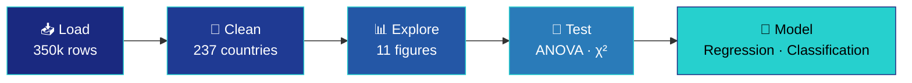

<!-- ╔══════════════════════════════════════════════════════════════╗ -->
<!-- ║                        H E A D E R                           ║ -->
<!-- ╚══════════════════════════════════════════════════════════════╝ -->

<div align="center">


<br><br>

<!-- ─────────────────  T E C H   B A D G E S  ───────────────── -->

[](https://www.python.org/)
[](https://jupyter.org/)
[](https://pandas.pydata.org/)
[](https://numpy.org/)
[](https://scikit-learn.org/)
[](https://scipy.org/)

<br>

<!-- ─────────────────  S T A T   C A R D S  ───────────────── -->

<table>
<tr>
<td align="center" width="20%">
<h3>📊</h3>
<b>350,085</b><br>
<sub>raw rows</sub>
</td>
<td align="center" width="20%">
<h3>🌍</h3>
<b>237</b><br>
<sub>countries</sub>
</td>
<td align="center" width="20%">
<h3>🗂️</h3>
<b>67 → 20</b><br>
<sub>columns refined</sub>
</td>
<td align="center" width="20%">
<h3>📈</h3>
<b>R² = 0.647</b><br>
<sub>regression fit</sub>
</td>
<td align="center" width="20%">
<h3>🎯</h3>
<b>81.2%</b><br>
<sub>classifier accuracy</sub>
</td>
</tr>
</table>

</div>


<!-- ╔══════════════════════════════════════════════════════════════╗ -->
<!-- ║                       O V E R V I E W                        ║ -->
<!-- ╚══════════════════════════════════════════════════════════════╝ -->

## 📖 &nbsp;Overview

An end-to-end exploratory data analysis, statistical testing, and machine learning project built on the **Our World in Data (OWID) COVID-19 dataset**.

The notebook walks the full data science pipeline — loading a raw 350k-row dataset, classifying and cleaning attributes, visualising distributions and relationships, running formal hypothesis tests, and finally fitting regression and classification models to predict a country's COVID-19 death rate from its demographic and socio-economic profile.

<div align="center">

> ### 💡 &nbsp;The headline finding
> A country's **median age** is the single strongest correlate of its COVID-19 death rate — **r = +0.65**
> *a stronger signal than GDP, hospital capacity, or vaccination coverage*

</div>


## 🧭 &nbsp;Table of Contents

<div align="center">
<table>
<tr>
<td align="center">📊<br><a href="#-dataset"><b>Dataset</b></a></td>
<td align="center">🛠️<br><a href="#️-tech-stack"><b>Tech Stack</b></a></td>
<td align="center">📁<br><a href="#-repository-structure"><b>Structure</b></a></td>
<td align="center">🚀<br><a href="#-getting-started"><b>Getting Started</b></a></td>
</tr>
<tr>
<td align="center">🔬<br><a href="#-analysis-pipeline"><b>Pipeline</b></a></td>
<td align="center">🏆<br><a href="#-key-results"><b>Key Results</b></a></td>
<td align="center">📈<br><a href="#-visualizations"><b>Visualizations</b></a></td>
<td align="center">⚠️<br><a href="#️-limitations"><b>Limitations</b></a></td>
</tr>
</table>
</div>


<!-- ╔══════════════════════════════════════════════════════════════╗ -->
<!-- ║                        D A T A S E T                         ║ -->
<!-- ╚══════════════════════════════════════════════════════════════╝ -->

## 📊 &nbsp;Dataset

<table>
<tr><td>🌐 <b>Source</b></td><td><a href="https://ourworldindata.org/covid-deaths">Our World in Data — COVID-19 Deaths</a></td></tr>
<tr><td>📄 <b>File expected</b></td><td><code>owid-covid-data.csv</code></td></tr>
<tr><td>📏 <b>Raw size</b></td><td>350,085 rows × 67 columns</td></tr>
<tr><td>📅 <b>Date range</b></td><td>January 2020 → October 2023</td></tr>
<tr><td>🎯 <b>Analysis subset</b></td><td>Latest record per country → <b>237 countries</b></td></tr>
</table>

### 🗂️ &nbsp;Columns used

The notebook narrows the 67 raw columns down to a focused set of 20.

<details>
<summary><b>🔽 &nbsp;Click to expand the full column breakdown</b></summary>

<br>

| | Group | Columns |
|:---:|---|---|
| 🏷️ | **Identifiers & time** | `location` · `continent` · `date` · `iso_code` |
| 🦠 | **Outcome variables** | `total_cases_per_million` · `total_deaths_per_million` · `new_cases_smoothed_per_million` · `reproduction_rate` · `positive_rate` |
| 💉 | **Policy & vaccination** | `people_vaccinated_per_hundred` · `people_fully_vaccinated_per_hundred` · `stringency_index` |
| 🏥 | **Socio-economic & health** | `population_density` · `median_age` · `gdp_per_capita` · `hospital_beds_per_thousand` · `life_expectancy` · `human_development_index` · `diabetes_prevalence` · `cardiovasc_death_rate` · `extreme_poverty` |

</details>

> [!NOTE]
> Rows whose `iso_code` starts with `OWID_` are aggregate regions (World, continents, income groups) rather than countries. These are dropped, along with any row missing a `continent`, so per-country statistics are never double-counted.


<!-- ╔══════════════════════════════════════════════════════════════╗ -->
<!-- ║                      T E C H   S T A C K                     ║ -->
<!-- ╚══════════════════════════════════════════════════════════════╝ -->

## 🛠️ &nbsp;Tech Stack

<div align="center">

| | Purpose | Libraries |
|:---:|---|---|
| 🐼 | **Data wrangling** | `pandas` · `numpy` |
| 🎨 | **Visualization** | `matplotlib` · `seaborn` |
| 📐 | **Statistics** | `scipy.stats` — `f_oneway` · `chi2_contingency` |
| 🤖 | **Machine learning** | `scikit-learn` — `LinearRegression` · `LogisticRegression` · `LabelEncoder` · `train_test_split` |
| ☁️ | **Environment** | Google Colab |

</div>


<!-- ╔══════════════════════════════════════════════════════════════╗ -->
<!-- ║                      S T R U C T U R E                       ║ -->
<!-- ╚══════════════════════════════════════════════════════════════╝ -->

## 📁 &nbsp;Repository Structure

```
Covid-19-Data-Analysis/
│
├── 📓 covid 19_data_analysis.ipynb            # Main notebook — full analysis pipeline
├── 📄 COVID-19  Project Proposal Report.pdf   # Project proposal
├── 📝 COVID19_Project_Report.docx             # Final written report
└── 📖 README.md
```


<!-- ╔══════════════════════════════════════════════════════════════╗ -->
<!-- ║                  G E T T I N G   S T A R T E D               ║ -->
<!-- ╚══════════════════════════════════════════════════════════════╝ -->

## 🚀 &nbsp;Getting Started

### ☁️ &nbsp;Option 1 — Google Colab *(recommended)*

The notebook was written for Colab and loads the dataset through `google.colab.files.upload()`.

```
1️⃣  Open covid 19_data_analysis.ipynb in Google Colab
2️⃣  Download owid-covid-data.csv from Our World in Data
3️⃣  Run the cells in order — select the CSV at the upload prompt
```

📥 &nbsp;Dataset download: **[owid/covid-19-data → public/data](https://github.com/owid/covid-19-data/tree/master/public/data)**

### 💻 &nbsp;Option 2 — Run locally with Jupyter

```bash
# 1 ─ Clone the repository
git clone https://github.com/info-AnikSaha/Covid-19-Data-Analysis.git
cd Covid-19-Data-Analysis

# 2 ─ Install dependencies
pip install pandas numpy matplotlib seaborn scikit-learn scipy jupyter

# 3 ─ Launch
jupyter notebook "covid 19_data_analysis.ipynb"
```

> [!TIP]
> To run locally, swap the Colab upload cell for a direct read:
> ```python
> df_raw = pd.read_csv("owid-covid-data.csv")
> ```


<!-- ╔══════════════════════════════════════════════════════════════╗ -->
<!-- ║                       P I P E L I N E                        ║ -->
<!-- ╚══════════════════════════════════════════════════════════════╝ -->

## 🔬 &nbsp;Analysis Pipeline

<div align="center">



</div>

The notebook is organised into 19 numbered cells, each a discrete step.

<details open>
<summary><b>🔽 &nbsp;Full step-by-step breakdown</b></summary>

<br>

| # | Stage | What it does |
|:---:|---|---|
| `01` | ⚙️ Setup | Install and import all libraries |
| `02` | 📥 Load | Upload and read `owid-covid-data.csv` |
| `03` | 👀 First look | `head()`, `tail()`, shape, dtypes, `describe()` |
| `04` | 🏷️ Attribute typing | Split columns into 62 numerical and 5 categorical |
| `05` | 🕳️ Missing values | Count and percentage per column + bar chart of the worst 20 |
| `06` | 🧹 Cleaning | Drop OWID aggregates, select key columns, take latest row per country |
| `07` | 📊 Univariate | Histograms with mean / median reference lines |
| `08` | 📦 Outliers | Box plots of cases and deaths by continent |
| `09` | 🌍 Group summaries | Continent-level averages as bar charts |
| `10` | 🔗 Bivariate | Scatter plots coloured by continent |
| `11` | 🔥 Correlation | Correlation matrix + masked triangular heatmap |
| `12` | 📐 Skewness | Skewness per variable, flagging \|skew\| > 1 |
| `13` | 🥧 Categorical | Pie chart of countries per continent + label encoding |
| `14` | 🧪 **ANOVA** | Do mean deaths/million differ across continents? |
| `15` | 🧪 **Chi-Square** | Is vaccination level independent of continent? |
| `16` | 📈 **Linear Regression** | Predict deaths/million from 7 features |
| `17` | 🔮 Prediction | Apply the fitted model to a hypothetical country |
| `18` | 🎯 **Logistic Regression** | Classify countries as high- vs low-death |
| `19` | 📋 Summary | Print a consolidated project recap |

</details>


<!-- ╔══════════════════════════════════════════════════════════════╗ -->
<!-- ║                     K E Y   R E S U L T S                    ║ -->
<!-- ╚══════════════════════════════════════════════════════════════╝ -->

## 🏆 &nbsp;Key Results

### 🌍 &nbsp;Continent-level averages *(latest snapshot)*

| | Continent | Avg cases / million | Avg deaths / million |
|:---:|---|---:|---:|
| 🥇 | **Europe** | **403,167** | **2,651** |
| 🥈 | Oceania | 233,090 | 656 |
| 🥉 | North America | 231,479 | 1,516 |
| 4️⃣ | Asia | 148,126 | 734 |
| 5️⃣ | Africa | 47,952 | 344 |

Europe records roughly **8× the case rate and 7× the death rate of Africa** — a gap driven at least as much by testing capacity, reporting infrastructure, and population age structure as by true infection prevalence.

<br>

### 🔥 &nbsp;Correlation with `total_deaths_per_million`

| Feature | r | Strength |
|---|---:|---|
| `median_age` | **+0.65** | 🟩🟩🟩🟩🟩🟩🟩⬜⬜⬜ |
| `human_development_index` | +0.56 | 🟩🟩🟩🟩🟩🟩⬜⬜⬜⬜ |
| `life_expectancy` | +0.49 | 🟨🟨🟨🟨🟨⬜⬜⬜⬜⬜ |
| `total_cases_per_million` | +0.45 | 🟨🟨🟨🟨🟨⬜⬜⬜⬜⬜ |
| `hospital_beds_per_thousand` | +0.35 | 🟧🟧🟧🟧⬜⬜⬜⬜⬜⬜ |
| `gdp_per_capita` | +0.25 | 🟧🟧🟧⬜⬜⬜⬜⬜⬜⬜ |

Age structure is the single strongest correlate of national death rates. The positive signs on HDI, life expectancy, and GDP look counter-intuitive at first glance, but are consistent with the age effect and with better case ascertainment in wealthier countries.

<br>

### 🧪 &nbsp;Hypothesis tests

<table>
<tr>
<td width="50%" valign="top">

#### 📐 One-way ANOVA
*Deaths per million across continents*

`H₀` All continents share the same mean

| | |
|---|---|
| F-statistic | **45.11** |
| p-value | **< 0.000001** |
| Verdict | ✅ **H₀ rejected** |

> Death rates differ significantly by continent.

</td>
<td width="50%" valign="top">

#### 📏 Chi-Square independence
*Vaccination level vs continent*

`H₀` Vaccination level is independent of continent

| | |
|---|---|
| χ² statistic | **44.95** |
| Degrees of freedom | 5 |
| p-value | **< 0.000001** |
| Verdict | ✅ **H₀ rejected** |

> Coverage is strongly tied to continent.

</td>
</tr>
</table>

The contingency table behind the Chi-Square result is stark — countries reaching **≥ 60% fully vaccinated**:

| Continent | ✅ High (≥60%) | ❌ Low (<60%) | Share high |
|---|---:|---:|---|
| Europe | 36 | 14 | 🟩🟩🟩🟩🟩🟩🟩⬜⬜⬜ |
| Asia | 34 | 16 | 🟩🟩🟩🟩🟩🟩🟩⬜⬜⬜ |
| North America | 24 | 17 | 🟨🟨🟨🟨🟨🟨⬜⬜⬜⬜ |
| Oceania | 20 | 4 | 🟩🟩🟩🟩🟩🟩🟩🟩⬜⬜ |
| South America | 8 | 6 | 🟨🟨🟨🟨🟨🟨⬜⬜⬜⬜ |
| **Africa** | **12** | **46** | 🟥🟥⬜⬜⬜⬜⬜⬜⬜⬜ |

<br>

### 🤖 &nbsp;Models

<table>
<tr>
<td width="50%" valign="top">

#### 📈 Linear Regression

*Target: `total_deaths_per_million`*
*7 predictors · 80/20 split*

| Metric | Value |
|---|---|
| **R²** | **0.647** |
| | *64.7% variance explained* |
| RMSE | 756.52 |
| MSE | 572,326.18 |

**Largest coefficients**

| Feature | Coefficient |
|---|---:|
| `human_development_index` | +2860.8 |
| `median_age` | +85.4 |
| `hospital_beds_per_thousand` | −37.2 |

</td>
<td width="50%" valign="top">

#### 🎯 Logistic Regression

*Binary classification against*
*the median death rate*

| Metric | Value |
|---|---|
| **Accuracy** | **81.2%** |
| Threshold | 944.9 per million |
| Class balance | 125 high / 112 low |

**Predictors used**

`median_age`
`gdp_per_capita`
`people_fully_vaccinated_per_hundred`
`human_development_index`
`hospital_beds_per_thousand`

</td>
</tr>
</table>

> [!WARNING]
> Raw regression coefficients are **not** directly comparable — the features sit on very different scales and were not standardised before fitting.


<!-- ╔══════════════════════════════════════════════════════════════╗ -->
<!-- ║                  V I S U A L I Z A T I O N S                 ║ -->
<!-- ╚══════════════════════════════════════════════════════════════╝ -->

## 📈 &nbsp;Visualizations

The notebook produces 11 figures across the pipeline.

<table>
<tr>
<td width="33%" valign="top" align="center">

### 🕳️
**Data quality**

Missing-value bar chart *(worst 20 columns)*

Skewness chart with ±1 thresholds

</td>
<td width="33%" valign="top" align="center">

### 📊
**Distributions**

2×3 histogram grid with mean / median markers

Box plots by continent *(outliers)*

Pie chart of countries per continent

</td>
<td width="33%" valign="top" align="center">

### 🔗
**Relationships**

Continent-level bar charts *(cases, deaths, vaccination)*

3 scatter plots *(GDP, age, vaccination vs deaths)*

Masked correlation heatmap *(11 variables)*

</td>
</tr>
<tr>
<td colspan="3" valign="top" align="center">

### 🤖
**Model diagnostics**

Actual-vs-predicted scatter *(regression)* &nbsp;·&nbsp; Confusion matrix heatmap *(classifier)* &nbsp;·&nbsp; Grouped bar chart of vaccination level by continent

</td>
</tr>
</table>


<!-- ╔══════════════════════════════════════════════════════════════╗ -->
<!-- ║                     L I M I T A T I O N S                    ║ -->
<!-- ╚══════════════════════════════════════════════════════════════╝ -->

## ⚠️ &nbsp;Limitations

<details open>
<summary><b>🔽 &nbsp;Caveats worth keeping in mind when reading these results</b></summary>

<br>

| | Limitation |
|:---:|---|
| 📉 | **Reported ≠ actual.** Case and death counts depend heavily on each country's testing and reporting capacity, so cross-country comparisons partly measure surveillance quality rather than epidemiology alone. |
| 🔀 | **Correlation is not causation.** The positive association between HDI/GDP and death rates reflects confounding with population age, not a causal effect of wealth. |
| 📸 | **A snapshot, not a time series.** Taking the latest row per country collapses a four-year pandemic into one number, discarding wave timing and dynamics. |
| 🕳️ | **Missing data is not random.** `weekly_icu_admissions` is absent for 97.1% of rows and `excess_mortality` for 96.5%; `extreme_poverty` is missing for 113 of 237 countries. Imputing with a mean or median would fabricate values, so the notebook drops rather than fills — which in turn shrinks the modelling sample. |
| 🎲 | **No feature scaling or regularisation**, and no cross-validation beyond a single 80/20 split, so the reported R² and accuracy carry meaningful variance. |

</details>


<!-- ╔══════════════════════════════════════════════════════════════╗ -->
<!-- ║                        F O O T E R                           ║ -->
<!-- ╚══════════════════════════════════════════════════════════════╝ -->

<div align="center">

## 👤 &nbsp;Author

### Anik Saha

[](https://github.com/info-AnikSaha)

<br>

### 🙏 &nbsp;Acknowledgements

Data courtesy of **[Our World in Data](https://ourworldindata.org/coronavirus)**

Maintained by the Global Change Data Lab &nbsp;·&nbsp; Released under **CC BY**

<br>

⭐ **If you found this analysis useful, consider starring the repo!**


</div>

